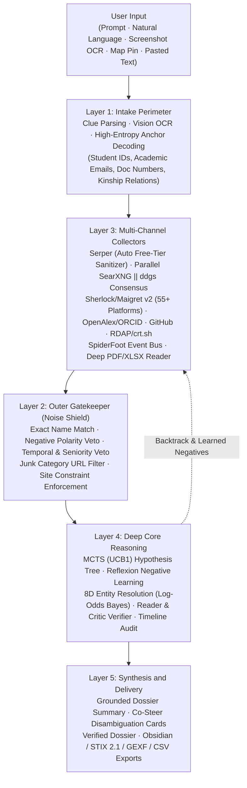

# Dupin

**Local-First 5-Layer Multi-Agent OSINT & 8-Dimensional Entity Resolution Workbench**

[](#testing)
[](LICENSE)
[](backend/requirements.txt)
[](frontend/package.json)
[](desktop/src-tauri/tauri.conf.json)
[](#mcp-and-ai-agent-integration)

**Dupin** (named after C. Auguste Dupin, literature's first analytical detective) is a local-first, human-in-the-loop OSINT investigation workbench available as a **Web UI**, a **native Windows Desktop App (Tauri v2)**, a **Command-Line Interface**, and an **MCP server** for AI coding agents.

Rather than relying on brittle single-platform username checks, Dupin treats identity investigation as a structured **5-Layer Concentric OSINT Pipeline** backed by an **8-Dimensional Entity Resolution Knowledge Graph** (SQLite + FTS5). It filters out homonym noise before LLM reasoning, inspects publicly indexed PDF and Excel tables, tracks calibrated uncertainty, and exports verifiable dossiers in **Obsidian Markdown**, **STIX 2.1**, **GEXF**, **CSV**, and **JSONL**.

> **Ethical and Legal Scope**
> Dupin strictly processes **publicly indexed open-source information (Public OSINT only)**. It does not bypass authentication walls, does not solve or evade CAPTCHAs, and does not scrape private accounts. For closed platforms, Dupin uses an explicit human-in-the-loop workflow (Boolean search dorks and an optional Browser Companion clipper).

---

## Architecture: 5-Layer Concentric OSINT Pipeline

Dupin isolates raw web noise from deep graph reasoning through five concentric layers. Every candidate document must pass the Layer 2 Gatekeeper before reaching the knowledge graph or LLM synthesis.



### Pipeline Module Map

| Layer | Code | Responsibility | Implementation |
|---|---|---|---|
| **Layer 1** | `L1_INTAKE_PERIMETER` | Parses comma-separated clues, comma-free natural language, kinship relations, long pasted paragraphs, Vision OCR, and high-entropy anchors (7–12 digit & alphanumeric student IDs, academic emails, doc numbers). | `backend/app/pipeline/layer1_intake.py`, `backend/app/core/anchor_decoder.py` |
| **Layer 2** | `L2_OUTER_GATEKEEPER` | Deterministic noise shield. Rejects non-matching homonyms, age-impossible seniority titles, grade/year conflicts, negative-constraint violations, and generic directory URLs with full rejection telemetry. | `backend/app/pipeline/layer2_gatekeeper.py` |
| **Layer 3** | `L3_MULTI_CHANNEL_COLLECTORS` | Runs entropy-first search (Serper with automatic Free-tier operator sanitizer, or parallel `SearXNG || ddgs` consensus fusion), 55+ platform username recon (`recursive_depth=2`), global registries (OpenAlex, ORCID, GitHub, RDAP, crt.sh), and deep PDF/XLSX inspection. | `backend/app/pipeline/layer3_collectors.py`, `backend/app/connectors/` |
| **Layer 4** | `L4_DEEP_CORE_REASONING` | Executes MCTS (UCB1) hypothesis expansion with backtracking, Reflexion negative-keyword learning, 8D Entity Resolution with Log-Odds Bayesian updates (`1/sqrt(k)` echo-chamber damping), and Critic anti-hallucination citation verification. | `backend/app/pipeline/layer4_deep_core.py`, `backend/app/agents/` |
| **Layer 5** | `L5_SYNTHESIS_DELIVERY` | Synthesizes grounded reports (Gemini Key Pool / Ollama Local / OpenAI / Zero-Key Extractive Fallback), generates Co-Steer confirmation cards, and persists graph claims and timeline events in SQLite WAL. | `backend/app/pipeline/layer5_synthesis.py`, `backend/app/core/exporters.py` |

### 8-Dimensional Entity Resolution Model

Every claim stored in the local knowledge graph is categorized across eight dimensions with explicit `POSITIVE` or `NEGATIVE` polarity and source provenance:

- `IDENTITY_CORE` (full name, DOB, student/institutional IDs)
- `ONLINE_ALIAS` (handles, email local-parts, recursive bio pivots)
- `EDUCATION_CAREER` (institutions, cohorts, employers, publications)
- `GEO_SPATIAL` (provinces, cities, map coordinates)
- `TEMPORAL_BEHAVIOR` (intake years, publication dates, activity windows)
- `SOCIAL_GRAPH` (kinship relations, co-authors, linked entities)
- `STYLOMETRY_LINGUISTIC` (handle anatomy, linguistic markers)
- `TECHNICAL_ARTIFACT` (domains, passive DNS, TLS CT logs, Gravatar hashes)

---

## Installation

Choose the method that matches your workflow. All data, SQLite databases, and Fernet-encrypted API keys stay strictly on your local machine.

### Method 1: Native Windows Desktop App (Tauri v2)

Dupin ships with a native Rust + WebView2 desktop shell (~20 MB, no Chromium bloat, no background console window). It automatically starts the local FastAPI backend on `127.0.0.1:8000` when launched and terminates it cleanly when closed.

1. Ensure the Python backend environment is initialized once (see Method 3 below).
2. Double-click `Dupin.exe` from the repository root (or build it yourself from source):

```powershell
# Build frontend bundle
cd frontend
npm install
npm run build

# Compile native Windows executable (requires Rust toolchain)
cd ..\desktop\src-tauri
cargo build --release
Copy-Item target\release\dupin-desktop.exe ..\..\Dupin.exe
Copy-Item target\release\WebView2Loader.dll ..\..\WebView2Loader.dll
```

### Method 2: Docker Compose (All-in-One with Local SearXNG)

Recommended for an isolated, reproducible stack including a local self-hosted **SearXNG** metasearch container (`127.0.0.1:8888`) paired with Dupin (`127.0.0.1:8000`):

```bash
git clone https://github.com/MtamVP/Dupin.git
cd Dupin
docker compose up -d --build
```

Open `http://127.0.0.1:8000` in your browser. In **Integrations -> Local Host**, set the SearXNG URL to `http://searxng:8080` (inside Docker) or `http://127.0.0.1:8888` (when running the backend directly on the host).

### Method 3: Local Python and Node Setup (Windows / macOS / Linux)

#### Windows (PowerShell / CMD)

```powershell
git clone https://github.com/MtamVP/Dupin.git
cd Dupin

# 1. Backend (Python 3.12+ with uv or venv)
cd backend
python -m venv .venv
.\.venv\Scripts\python.exe -m pip install -r requirements.txt

# 2. Frontend (Node.js 20+)
cd ..\frontend
npm install
npm run build

# 3. Start Dupin locally
cd ..\backend
.\.venv\Scripts\python.exe -m app.cli serve
```

#### macOS / Linux (Bash / Zsh)

```bash
git clone https://github.com/MtamVP/Dupin.git
cd Dupin

# 1. Backend
cd backend
python3 -m venv .venv
.venv/bin/python -m pip install -r requirements.txt

# 2. Frontend
cd ../frontend
npm install
npm run build

# 3. Start Dupin locally
cd ../backend
.venv/bin/python -m app.cli serve
```

Once running, open `http://127.0.0.1:8000`.

---

## Usage

### 1. Terminal / CLI Usage (Headless Mode)

Dupin provides a direct terminal CLI (`python -m app.cli`) for scriptable investigations, username scans, and Boolean dork generation without opening a browser.

```bash
# Start the local web workbench and API server (default 127.0.0.1:8000)
python -m app.cli serve --port 8000

# Run a full 5-layer OSINT investigation from the terminal
python -m app.cli investigate "Nguyen Van Mau, HCMUT, 2005"

# Output structured JSON for piping into jq or downstream tools
python -m app.cli investigate "Nguyen Van Mau, 2550999, HCMUT" --json

# Offline / local-graph-only mode (no live network search)
python -m app.cli investigate "Nguyen Van Mau, HCMUT" --no-live

# Scan a username across 55+ public platforms (Sherlock/Maigret v2 engine)
python -m app.cli scan-username example_handle --depth 2 --hint "HCMUT"

# Generate multi-variant Boolean search dorks
python -m app.cli dorks "Nguyen Van Mau" --org "HCMUT" --exclude "PhD"

# Start the MCP JSON-RPC 2.0 Stdio server for AI coding agents
python -m app.cli mcp
```

On Windows from `backend\`, replace `python` with `.\.venv\Scripts\python.exe`.

### 2. Web and Desktop Workbench

Launch `Dupin.exe` or open `http://127.0.0.1:8000`. Dupin supports multiple input styles in the composer:

- **Structured clues**: `Full Name, Institution, DD/MM/YYYY, StudentID, -ExcludeTerm`
- **Natural language and relational queries**: `Person A son of Person B`, `Nguyen Van Mau sinh ngay 15/05/2005 hoc tai UEH`
- **Pasted public paragraphs / notes**: Paste a bio or excerpt directly; Layer 1 automatically extracts labeled names, dates, locations, and numeric IDs.
- **Multimodal inputs**: Paste screenshots (`Ctrl+V`) for Vision OCR table extraction, attach `.txt`/`.md`/`.csv` files, or pin coordinates on the map.
- **Keyboard shortcuts**: `Enter` send · `Shift+Enter` newline · `Ctrl+K` new investigation · `Ctrl+B` toggle sidebar · `Ctrl+\` toggle right panel.

### 3. Optional API Keys and Local Engines

Dupin works **out of the box with zero API keys** (using parallel `SearXNG || ddgs`, public registries, and extractive synthesis). To unlock Google organic search and LLM synthesis, open **Integrations & Plugins** in the top bar:

- **Serper.dev (`serper`)**: Google Search API. Includes an automatic Free-tier query sanitizer that rewrites blocked dork operators on HTTP 400 without penalizing key health.
- **Gemini / OpenAI (`gemini`, `openai`)**: Multi-key round-robin rotation pool with automatic HTTP 429 cooldown failover.
- **Ollama Local**: Point to `http://localhost:11434` (e.g. `qwen2.5:7b`) for 100% offline LLM synthesis.
- **Security**: All API keys are encrypted at rest in SQLite using **Fernet (AES-128-CBC + HMAC-SHA256)** with a local machine key (`backend/data/.stalker_key`).

### 4. Browser Companion Extension (Human-in-the-Loop Clipper)

1. Open `chrome://extensions` (or `edge://extensions`) and enable **Developer mode**.
2. Click **Load unpacked** and select the `extension/` directory.
3. While viewing any public webpage, click the **Dupin Companion** icon to clip verified snippets directly into the active investigation dossier.

---

## MCP and AI Agent Integration

Dupin exposes **11 OSINT tools** over **Model Context Protocol (JSON-RPC 2.0)** via both Stdio (`python -m app.cli mcp`) and HTTP (`POST http://127.0.0.1:8000/api/mcp`).

| MCP Tool | Purpose |
|---|---|
| `stalker_deep_investigate` | Run the full 5-layer concentric OSINT pipeline |
| `stalker_generate_dorks` | Generate multi-variant Boolean search dorks with exclusions |
| `stalker_decode_anchors` | Decode student IDs, academic emails, doc numbers, and class codes |
| `stalker_scan_username` | Scan handles across 55+ platforms with Soft-404 and recursive bio pivots |
| `stalker_analyze_phone` | Parse phone metadata and generate phone OSINT dorks |
| `stalker_recon_domain_email` | Passive DNS (DoH), crt.sh CT logs, RDAP, Gravatar, OpenPGP recon |
| `stalker_ingest_snippet` | Ingest a user-provided public snippet and extract claims |
| `stalker_analyze_and_verify` | Run Reader + Critic citation verification and timeline audit |
| `stalker_resolve_entities` | Compare two graph nodes across all 8 dimensions with negative veto |
| `stalker_search_graph` | Search local knowledge graph via SQLite FTS5 (BM25) + Jaro-Winkler |
| `stalker_suggest_pivots` | Rank next investigation pivots by information gain |

AI-native discovery files are also served at `/llms.txt`, `/llms-full.txt`, `/api/catalog.json`, and `/api/pipeline/architecture`.

---

## Exports

From the right-hand **Dossier** panel (with optional **PII Redaction** toggle):

- **Obsidian Markdown** (`/api/workspaces/{id}/export/obsidian`)
- **STIX 2.1 Threat Intelligence Bundle** (`/api/workspaces/{id}/export/stix`)
- **GEXF Network Graph** (for Gephi)
- **CSV / JSONL**

---

## Repository Structure

```text
dupin/
├── backend/
│   ├── app/
│   │   ├── pipeline/        # 5-Layer Concentric Pipeline (L1..L5 + contracts)
│   │   ├── agents/          # MCTS Planner, Reader, Critic, 8D Entity Resolver
│   │   ├── connectors/      # WebSearch, UsernameRecon v2, DocumentReader, MirrorPivots, Registries
│   │   ├── core/            # GraphStore (SQLite+FTS5), Fernet Vault, KeyPool, AnchorDecoder, Exporters
│   │   ├── plugins/         # SpiderFoot-style Event Bus & Plugin Registry
│   │   ├── cli.py           # Terminal CLI (serve, investigate, scan-username, dorks, mcp)
│   │   ├── main.py          # FastAPI server + SSE streaming + REST API
│   │   └── mcp_server.py    # MCP JSON-RPC 2.0 server (11 tools)
│   └── tests/               # Full automated test suite (pytest)
├── frontend/                # React 19 + TypeScript + Vite (DESIGN.md editorial light/dark UI)
├── desktop/                 # Native Windows Desktop App (Tauri v2 + Rust + WebView2)
├── extension/               # Manifest V3 Browser Companion Clipper
├── searxng/                 # Local SearXNG metasearch configuration
├── DESIGN.md                # Design system specification and tokens
├── catalog.json             # Machine-readable tool and pipeline catalog
└── docker-compose.yml       # All-in-one local stack (Dupin + SearXNG)
```

---

## Testing

All changes must pass the full backend test suite and frontend production build:

```powershell
# Backend unit and integration tests
cd backend
.\.venv\Scripts\python.exe -m pytest -v

# Frontend TypeScript check and Vite production build
cd ..\frontend
npm run build
```

---

## License

Released under the [MIT License](LICENSE). See [SECURITY.md](SECURITY.md) for vulnerability reporting and ethical usage policies.
