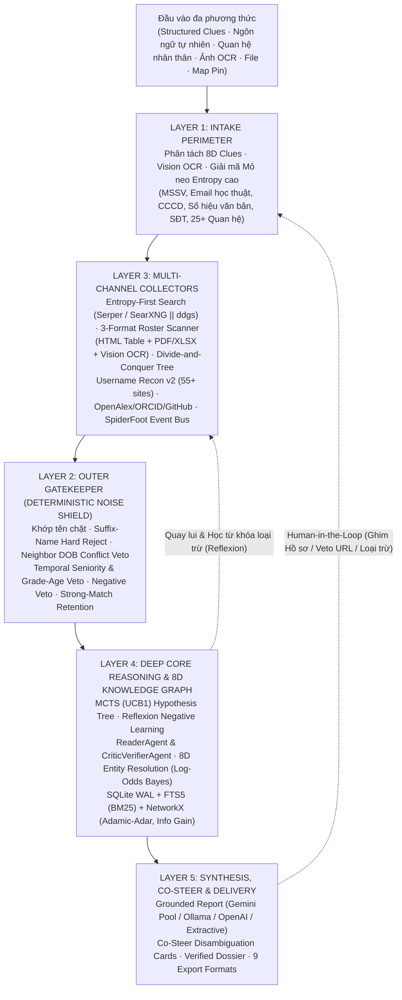

# Dupin (Stalker++)

**Local-First 5-Layer Concentric Multi-Agent OSINT & 8-Dimensional Entity Resolution Workbench**

[](#10-kiểm-thử--cài-đặt)
[](LICENSE)
[](backend/requirements.txt)
[](frontend/package.json)
[](desktop/src-tauri/tauri.conf.json)
[-26251e)](#8-mcp--ai-agent-integration)

---

> **Mục đích tài liệu này**  
> Đây là bản đặc tả kỹ thuật đầy đủ (Architecture Blueprint) tổng hợp toàn bộ **triết lý thiết kế, ngăn xếp công nghệ, thuật toán, cơ chế lọc nhiễu, pipeline 5 tầng, mô hình đồ thị 8 chiều, và các đánh đổi (trade-offs)** của dự án **Dupin (Stalker++)** — phục vụ cho việc **thẩm định kiến trúc (Architecture Review)** trước khi mở rộng sang giai đoạn tiếp theo.

> **Ranh giới Đạo đức & Pháp lý (Hard Guardrails)**  
> Dupin **chỉ xử lý dữ liệu công khai (Public OSINT only)**. Hệ thống tuyệt đối không vượt tường đăng nhập, không tự động giải/vượt CAPTCHA, không cào dữ liệu riêng tư. Với nền tảng đóng (như Facebook), Dupin áp dụng quy trình **Human-in-the-Loop** tường minh (sinh Boolean Dork để người dùng tự kiểm tra và nhận snippet/ảnh công khai người dùng cung cấp hoặc kẹp qua Browser Companion Extension).

---

## 1. Bài toán & Triết lý Thiết kế

Các công cụ OSINT truyền thống (Sherlock, Maigret, SpiderFoot, Maltego) hoặc các agent bọc LLM đơn giản thường vấp phải 4 giới hạn lớn khi điều tra thực thể ngoài đời thực (đặc biệt trong hệ sinh thái tiếng Việt):

1. **Nhiễu đồng âm (Homonym Explosion)**: Một tên gọi phổ biến có thể trả về hàng trăm cá nhân khác nhau về thế hệ, tổ chức, địa phương hoặc biến thể tên bị nối thêm từ/biệt danh (`<FullName> <ExtraToken>`). Nếu đổ thẳng kết quả thô vào LLM, LLM sẽ trộn lẫn dữ kiện của nhiều người thành một hồ sơ ảo giác.
2. **Dữ liệu thật nằm ẩn trong tài liệu phi chuẩn**: Danh sách học sinh/sinh viên công khai trên cổng trường học Việt Nam (`*.edu.vn`) thường tồn tại ở 3 dạng khó tìm bằng Google dork thông thường: (a) bảng HTML tách cột `<td>Họ đệm</td><td>Tên</td>` khiến truy vấn ngoặc kép trả về 0 kết quả; (b) file PDF/Excel hàng trăm trang (hoặc bản mirror trên Scribd/Studocu); (c) **slide ảnh `.png` từng lớp** không thể tìm bằng văn bản.
3. **LLM thiếu trí nhớ có cấu trúc & cơ chế quay lui**: Một vòng RAG tuyến tính không biết cách tách nhánh Chia-để-trị khi thiếu mảnh ghép, không biết quay lui khi đi vào ngõ cụt, và dễ bị hiệu ứng "buồng vang" (echo chamber) khi 10 trang web copy-paste cùng một tin giả.
4. **Quyền riêng tư & Zero-Key Resilience**: Dữ liệu điều tra và API key cần nằm 100% cục bộ trên máy người dùng (local-first), có thể chạy không cần API key thương mại (zero-key mode) hoặc kết hợp đa key/Ollama local.

**Cách tiếp cận của Dupin**: Thiết kế một **Pipeline đồng tâm 5 tầng (5-Layer Concentric OSINT Pipeline)** kết hợp **Neuro-Symbolic AI** — tách bạch hoàn toàn *tầng lọc nhiễu xác định (Deterministic Perimeter Gatekeeper)* khỏi *tầng suy luận xác suất & đồ thị tri thức 8 chiều (Probabilistic Core + 8D Knowledge Graph)* và *tầng tổng hợp LLM (Grounded Synthesis)*.

---

## 2. Kiến trúc Tổng thể (5-Layer Concentric OSINT Pipeline)



### Bản đồ Module (Codebase Map)

| Tầng | Mã định danh | Vai trò cốt lõi | Module cài đặt |
|---|---|---|---|
| **Layer 1** | `L1_INTAKE_PERIMETER` | Chuẩn hóa đầu vào đa phương thức, OCR ảnh bảng biểu, giải mã mỏ neo entropy cao, hợp nhất ngữ cảnh phiên & Verified Dossier, bảo vệ mục tiêu chính khi pivot sang người thân. | `backend/app/pipeline/layer1_intake.py`, `backend/app/core/anchor_decoder.py`, `backend/app/connectors/multimodal_intake.py` |
| **Layer 2** | `L2_OUTER_GATEKEEPER` | Lá chắn nhiễu xác định (deterministic) đứng trước Lõi. Chấm điểm giao thoa đa manh mối, phủ quyết cứng đồng âm/lệch tuổi/lệch DOB/dư chữ tên, ghi log lý do chặn (`rejected_by_reason`). | `backend/app/pipeline/layer2_gatekeeper.py` |
| **Layer 3** | `L3_MULTI_CHANNEL_COLLECTORS` | Điều phối tìm kiếm ưu tiên entropy (Serper / `SearXNG \|\| ddgs`), quét danh sách trường 3 định dạng (HTML + PDF/XLSX + Vision OCR ảnh), cây Chia-để-trị, Username Recon 55+ nền tảng, Global Registries, Plugin Event Bus. | `backend/app/pipeline/layer3_collectors.py`, `backend/app/pipeline/investigation_tree.py`, `backend/app/connectors/*`, `backend/app/plugins/*` |
| **Layer 4** | `L4_DEEP_CORE_REASONING` | Cây giả thuyết MCTS (UCB1) có quay lui, Reflexion học từ khóa âm, Reader rút trích claim, Critic kiểm chứng trích dẫn gốc chống ảo giác, Entity Resolution 8D (Log-Odds Bayes), Graph Analytics. | `backend/app/pipeline/layer4_deep_core.py`, `backend/app/agents/*`, `backend/app/core/graph_store.py`, `backend/app/core/bayesian.py`, `backend/app/core/graph_analytics.py` |
| **Layer 5** | `L5_SYNTHESIS_DELIVERY` | Tổng hợp báo cáo bám chặt Ground Truth (Gemini Key Pool / Ollama / OpenAI / Zero-Key Extractive), sinh thẻ Co-Steer xác nhận trùng tên, xuất hồ sơ 9 định dạng (có che PII & lọc Verified-Only). | `backend/app/pipeline/layer5_synthesis.py`, `backend/app/core/exporters.py`, `backend/app/core/llm_provider.py` |

---

## 3. Chi tiết Kỹ thuật từng Tầng & Thuật toán

### 3.1. Layer 1 — Intake Perimeter & High-Entropy Anchor Decoding
- **Phân tách đầu vào đa dạng** (`parse_user_prompt`):
  - Hỗ trợ cả dạng cấu trúc (`Họ tên, DD/MM/YYYY, Tổ chức, Mã định danh, -LoạiTrừ`), ngôn ngữ tự nhiên không dấu phẩy, lẫn đoạn văn bản/tiểu sử dài dán trực tiếp.
  - Tự động làm sạch động từ/markdown dính vào tên trường (ví dụ stripping `"đang học"`, `"từng học cấp 2"`, tiêu đề `### ...` từ đầu ra OCR) và tách riêng chuyên ngành sang `keywords`.
  - Tránh nhầm họ Việt Nam với tổ chức (ví dụ họ `"Trương"` không bị nhận nhầm thành `"trường"`).
- **Trích xuất 25+ loại quan hệ nhân thân & xã hội** (`_NL_RELATION_PATTERNS`):
  - Gia đình (`CHILD_OF`, `PARENT_OF`, `GRANDPARENT_OF`, `SIBLING_OF`, `RELATIVE_OF`), tình cảm (`SPOUSE_OF`, `PARTNER_OF`), học thuật (`CLASSMATE_OF`, `STUDENT_OF`, `MENTOR_OF`), công việc/xã hội (`COLLEAGUE_OF`, `MANAGER_OF`, `SUBORDINATE_OF`, `ROOMMATE_OR_NEIGHBOR_OF`, `FRIEND_OR_ASSOCIATE_OF`, `OWNS_ACCOUNT`).
  - **Secondary Person Pivot Protection**: Khi người dùng đang điều tra mục tiêu A và nhập thông tin về người thân B (`is_secondary_person_pivot`), hệ thống gắn nhãn phụ ` (Tên B)` thay vì ghi đè `Họ và tên` của mục tiêu chính trong Verified Dossier.
- **Giải mã Mỏ neo Entropy cao (`anchor_decoder.py`)**:
  - **MSSV (Student ID)**: Tự động nhận diện và giải mã khóa/trường từ cấu trúc mã số (UEH 11 số `3125102xxxx` -> K51/2025, HUST 8 số `20xx`, HCMUT 7 số `YYxxxxx`, UIT/VNU 8 số `YYxxxxx`, và MSSV chữ-số có nhãn).
  - **Lọc chống nhận nhầm Mã ngành (`is_vn_major_code`)**: Tự động loại trừ mã ngành đào tạo đại học 7 chữ số theo Thông tư 09/2022/TT-BGDĐT (`7xxxxxx`, ví dụ `7340404` = Quản trị nhân lực) khỏi `student_ids` (kể cả khi khôi phục từ lịch sử workspace cũ) để tránh tràn kết quả điểm chuẩn.
  - **Các mỏ neo khác**: Email học thuật (tự suy ra trường + nhúng MSSV từ local-part), CCCD 12 số (giải mã 63 tỉnh/thành + giới tính + năm sinh theo TT07/2016/TT-BCA), biển số xe VN, MST (`10` hoặc `10-3` số), SBD, ORCID, số hiệu văn bản (`QĐ/TB/CV`), mã lớp/LHP, Social UID (Facebook/Telegram/LinkedIn), ví EVM (`0x...`), SĐT VN.
- **Multimodal Intake**: Dán ảnh `Ctrl+V` gửi qua Gemini/Ollama Vision OCR trích xuất bảng/thông tin; đính kèm `.txt/.md/.csv`; ghim tọa độ địa lý qua Map Picker.

---

### 3.2. Layer 2 — Outer Gatekeeper (Deterministic Noise Shield)
Mọi kết quả từ Internet **bắt buộc** đi qua `OuterGatekeeper.evaluate_candidate` và `_evaluate_relevance_detailed` trước khi chạm tới Knowledge Graph hoặc LLM. Mọi quyết định loại đều ghi telemetry minh bạch (`GatekeeperTelemetry.rejected_by_reason`):

1. **Veto vĩnh viễn từ người dùng (`user_rejected_source`)**: URL đã bị bấm "Không đúng" bị chặn vĩnh viễn trong workspace.
2. **Vệ sinh URL & Trang rác (`junk_url`)**: Chặn trang chuyên mục chung chung, trang thương mại điện tử, URL trùng lặp (sau khi percent-decode chuẩn hóa), tiêu đề > 180 ký tự.
3. **Phủ quyết từ khóa âm (`negative_keyword`)**: Chặn ngay ứng viên chứa từ khóa loại trừ do người dùng nhập (`-<ExcludeTerm>`) hoặc do Reflexion tự học.
4. **Phủ quyết bất khả thi theo Thời gian & Thế hệ**:
   - `temporal_seniority_veto`: Chặn hồ sơ mang chức danh/học hàm vượt tuổi sinh học (ví dụ `GS.`, `PGS.`, `TS.`, `ThS.`, `Giám đốc`, `Hiệu trưởng` đối với mục tiêu ở độ tuổi học sinh/sinh viên).
   - `temporal_grade_age_veto`: Chặn tài liệu học sinh có niên khóa mâu thuẫn với năm sinh mục tiêu.
5. **Phủ quyết lệch Năm sinh ngay cạnh Tên (`dob_mismatch_veto`)**: Khi biết `birth_year` mục tiêu và mọi vị trí xuất hiện tên mục tiêu trong đoạn trích danh sách đều kéo theo ngày sinh `DD/MM/YYYY` hợp lệ (`1950..2018`) có năm sinh khác hẳn năm sinh mục tiêu, hệ thống từ chối thẳng.
6. **Phủ quyết cứng Tên bị dư chữ / Biệt danh (`suffix_name_mismatch`)**:
   - Nếu mọi lần xuất hiện `<target_name>` đều bị theo sau ngay bởi một từ viết hoa khác (`<TargetName> <ExtraCapitalizedToken>`) không nằm trong tập từ siêu dữ liệu hợp lệ (`_NON_NAME_FOLLOWERS`: giới tính, dân tộc, lớp, địa phương, xếp loại...), và không có ngày sinh/SĐT trùng khớp tuyệt đối -> **Hard-reject**.
7. **Kiểm soát đồng âm tiếng Việt khác**: Phạt/gắn cờ `prefix_surname_mismatch` (dư họ phía trước), `diacritic_name_mismatch` (khác dấu thanh khi cả hai đều có dấu), và bộ lọc ngữ cảnh lịch sử (tránh nhầm tên riêng với nhân vật/sự kiện lịch sử).
8. **Chấm điểm giao thoa (Cross-Clue Scoring) & Giữ nguồn mạnh (`Strong-Match Retention`)**:
   - Cộng điểm khi đồng xuất hiện: Họ tên chính xác + Ngày sinh (`+5`) / SĐT (`+5`) / Đồng xuất hiện với người thân (`+4`) / Dòng danh sách chuẩn `<Tên> <DOB> [Nam/Nữ] <MSSV>` (`+4`) / Trường học / Địa phương / Đồng thuận đa máy tìm kiếm (`SearXNG + ddgs`).
   - **Progressive Unverified Rotation (`unverified_rotated_out`)**: Ở các lượt sau trong cùng workspace, hệ thống chỉ xoay vòng (đẩy ra để nhường chỗ cho tin mới) các nguồn yếu/mơ hồ (`score < 4`); **tuyệt đối giữ lại** các nguồn đã khớp mạnh với input (`score >= 4` và không lỗi tên/dấu, hoặc `force_keep=True`) kể cả khi người dùng quên bấm `Lưu Hồ sơ`.

---

### 3.3. Layer 3 — Multi-Channel Collectors & 3-Format Roster Scanner
- **Chiến lược truy vấn ưu tiên Entropy (`layer3_collectors.py`)**:
  - **Vòng 1 (6 truy vấn song song)**: Tối đa 2 truy vấn ID/MSSV độ đặc hiệu cao + **luôn bảo đảm** 2 truy vấn cốt lõi không bao giờ bị đẩy ra ngoài: `natural_name_dob` (không ngoặc kép, để bắt bảng HTML tách cột `<td>Họ đệm</td><td>Tên</td>`) và `intersect_org` (trường học trong prompt hiện tại) + các truy vấn giao thoa chéo còn lại.
  - **Vòng 2 (Deep ReAct)**: Quét các mỏ neo mới phát hiện từ Vòng 1 (số hiệu văn bản, mirror Scribd/Studocu, `site:edu.vn`, `filetype:pdf`).
- **Bộ định tuyến Search Engine (`connectors/web_search.py`)**:
  - **Serper.dev (Google Organic)**: Tự động suy luận vị trí địa lý động `infer_serper_location(query)` từ tỉnh/thành hoặc trường học trong truy vấn (mặc định trung lập `"Vietnam"`, không hardcode cố định một thành phố); tự động retry bỏ ngoặc kép khi trả về 0 kết quả; tự động làm sạch toán tử bị chặn trên gói Free khi gặp HTTP 400 mà không phạt key; **short-circuit** bỏ qua SearXNG/ddgs ngay khi Serper trả về HTTP 200 để tối ưu tốc độ.
  - **Zero-Key Fallback**: Chạy song song `SearXNG (local container) || ddgs` và hợp nhất kết quả theo điểm đồng thuận (`consensus_score`). Hỗ trợ tự động fallback `localhost` -> `http://searxng:8080` khi chạy trong Docker.
- **Quét Cổng Danh sách Trường học 3 Định dạng (`connectors/document_reader.py`)**:
  1. **Inline HTML Tables**: Tải trực tiếp trang thông báo `*.edu.vn`, bóc tách cấu trúc bảng HTML (xử lý được trường hợp họ đệm và tên nằm ở 2 ô `<td>` liên tiếp).
  2. **Embedded PDF / Excel (`.pdf`, `.xlsx`) & Document Mirrors**: Tải và trích xuất tới 120 trang PDF (`pypdf`) / sheet Excel (`openpyxl`) + đọc bản lưu công khai trên Scribd/Studocu (`doc_mirror_reader.py`).
  3. **Vision OCR song song trên ảnh danh sách lớp (`.png/.jpg`)**: Phát hiện cổng thông tin đăng danh sách dạng ảnh, lọc ảnh theo khối/nhóm ước lượng từ năm sinh mục tiêu, chạy Gemini Vision OCR song song theo lô để rút ra dòng bảng biểu khớp chính xác (tên ảnh, lớp/nhóm, họ tên, ngày sinh).
- **Cây quyết định Chia-để-trị Thích ứng (`pipeline/investigation_tree.py`)**:
  - Hàm `should_activate_divide_and_conquer` chỉ kích hoạt khi thật sự cần (0 hit, tên rút gọn thiếu ngày sinh, hoặc còn ít hit mạnh và một trường cụ thể chưa có kết quả trực tiếp) — tránh chạy máy móc gây chậm.
  - Tách nhánh độc lập theo từng trường / từ khóa, kiểm tra tính nhất quán cùng thực thể (`verify_same_person_consistency`), đánh dấu `CONFIRMED` hoặc quay lui `DEAD_END_BACKTRACKED`.
- **Username Recon v2 (`connectors/username_recon.py`)**:
  - Quét 55+ nền tảng công khai định nghĩa trong `backend/app/data/sites_manifest.json` qua 5 cơ chế kiểm tra, lọc Soft-404, và pivot đệ quy từ bio/link tìm được (`recursive_depth=2`).
- **Global Structured Registries & Passive Infrastructure Recon**:
  - Học thuật & mã nguồn: **OpenAlex**, **ORCID**, **GitHub API** (`global_intel.py`, `github_api.py`).
  - Hạ tầng thụ động (`domain_email_recon.py`): **Cloudflare DoH** (DNS/MX), **RDAP**, **crt.sh** (Certificate Transparency logs), **Wayback CDX**, **Shodan InternetDB**, **Gravatar MD5**, **OpenPGP**.
  - SĐT (`phone_recon.py`): Chuẩn hóa đầu số/nhà mạng VN và sinh dork số điện thoại.
- **SpiderFoot-style Event Bus (`backend/app/plugins/`)**:
  - Kiến trúc plugin hướng sự kiện (`EventBus`, `PluginRegistry`, `Correlator`) với **11 plugin** tích hợp sẵn chạy tự động khi phát hiện thực thể/domain/email/handle mới.

---

### 3.4. Layer 4 — Deep Core Reasoning & 8D Knowledge Graph
- **Mô hình Đồ thị Tri thức 8 Chiều (`core/schemas.py`, `core/graph_store.py`)**:
  - Mỗi thực thể (`Node`: `Person`, `Organization`, `Location`, `Account`, `Document`...) mang các `FeatureClaim` thuộc 8 chiều:
    1. `identity` (Họ tên, ngày sinh, MSSV, CCCD)
    2. `spatiotemporal` (Địa điểm, tỉnh/thành, tọa độ, mốc thời gian)
    3. `education_career` (Trường học, niên khóa, ngành, nơi làm việc)
    4. `interests_skills` (Chứng chỉ IELTS, chuyên ngành, kỹ năng)
    5. `stylometry_behavior` (Cấu trúc handle, phong cách ngôn ngữ)
    6. `technical_artifact` (Email, domain, MX/DNS, ports, subdomains, Gravatar)
    7. `relational` (25+ loại cạnh quan hệ giữa các thực thể)
    8. `negative_constraint` (Ràng buộc loại trừ `NEGATIVE` — có quyền phủ quyết)
  - Lưu trữ cục bộ trong **SQLite (WAL mode + `busy_timeout`)** kết hợp chỉ mục toàn văn **FTS5 (BM25)** cho blocking ứng viên tốc độ cao.
  - Cơ chế **Edge Upsert Deduplication** theo `(workspace_id, source_id, target_id, relation)` và **đồng bộ 2 chiều** từ Verified Dossier sang Graph (`_sync_dossier_item_to_graph`).
- **8D Entity Resolution & Bayesian Log-Odds (`agents/resolver.py`, `core/bayesian.py`)**:
  - So khớp hai thực thể trên cả 8 chiều bằng: **Jaro-Winkler**, khóa ngữ âm tiếng Việt (`normalizer.py`), giải phẫu cấu trúc handle, cosine stylometry, và kiểm tra phủ quyết `NEGATIVE`.
  - Cập nhật xác suất đồng nhất bằng **Log-Odds Bayesian Updating** kèm hệ số giảm chấn buồng vang **$1/\sqrt{k}$ (Echo-Chamber Damping)** để tránh tình trạng nhiều nguồn sao chép cùng một nội dung làm tăng giả tạo độ tin cậy.
- **MCTS (UCB1) Planner & Reflexion (`agents/planner.py`, `agents/playbooks.py`)**:
  - Mở rộng không gian giả thuyết theo thuật toán **Monte Carlo Tree Search (UCB1)**, đánh giá `reward`, ghi nhận trạng thái `EXPANDED` / `DEAD_END_BACKTRACKED`, và tự rút trích từ khóa loại trừ qua vòng lặp **Reflexion**.
- **ReaderAgent & CriticVerifierAgent (`agents/reader.py`, `agents/critic.py`)**:
  - `ReaderAgent`: Rút trích claim neuro-symbolic tiếng Việt/Anh; kiểm tra tính hợp lý của email với chủ thể (`is_email_plausible_for_subject`) để chặn email giảng viên/người đứng cạnh trong danh sách gắn nhầm vào sinh viên.
  - `CriticVerifierAgent`: **Verbatim Quote Grounding** — mọi claim ghi vào đồ thị phải có trích dẫn nguyên văn và URL nguồn kiểm chứng được; thực hiện kiểm toán dòng thời gian (Timeline Reconstruction & Gap Analysis).
- **Graph Analytics (`core/graph_analytics.py` + NetworkX)**:
  - **Adamic-Adar** dự đoán liên kết ẩn, **Label Propagation** phát hiện cụm cộng đồng, **Betweenness Centrality** tìm nút cầu nối, và **Information Gain Frontier Ranking** gợi ý điểm pivot có độ lợi thông tin cao nhất tiếp theo.

---

### 3.5. Layer 5 — Grounded Synthesis, Co-Steer & Multi-Format Export
- **LLM Adapter & Key Pool (`core/llm_provider.py`, `core/key_pool.py`, `core/crypto.py`)**:
  - Hỗ trợ 4 chế độ linh hoạt: **Gemini Multi-Key Pool** (xoay vòng round-robin + tự động cooldown khi HTTP 429, thứ tự model `gemini-4-hydrogen` -> `gemini-3.8-flash` -> `gemini-3.6-flash` -> `gemini-3.5-flash-lite` -> `gemini-3.1-flash-lite`), **Ollama Local** (mặc định timeout 90s, tự động ánh xạ `host.docker.internal:11434` khi chạy trong Docker), **OpenAI-compatible**, và **Zero-Key Extractive Fallback**.
  - Toàn bộ API key được mã hóa tại chỗ bằng **Fernet (AES-128-CBC + HMAC-SHA256)** với khóa cục bộ `backend/data/.stalker_key`.
- **Grounded Synthesis (`layer5_synthesis.py`)**:
  - Đưa toàn bộ **Verified Dossier (`ctx.dossier_blob`)** làm `Ground Truth` bắt buộc vào prompt tổng hợp, yêu cầu phân tách rõ: (1) Nguồn đáng giá nhất, (2) Nhận định khoanh vùng & Độ bất định (nhánh xác nhận vs nhánh quay lui), (3) Gợi ý bước tra cứu tiếp theo.
- **Human-in-the-Loop Co-Steer**:
  - Tự động sinh thẻ xác nhận **Co-Steer** cho các ứng viên trùng tên nhưng khác tổ chức/ngữ cảnh -> người dùng bấm 1 nút `Loại trừ "-TừKhóa"` hoặc `Đúng là người này` để cập nhật ngay cho lượt sau.
- **Xuất hồ sơ 9 định dạng (`core/exporters.py`)**:
  - **Word (`.docx`, có tùy chọn đọc sâu tài liệu)**, **PDF**, **Excel (`.xlsx`)**, **HTML**, **Obsidian Markdown**, **STIX 2.1 Threat Intelligence Bundle**, **GEXF (Gephi)**, **CSV**, **JSONL**.
  - Hỗ trợ cờ **Verified-Only** (chỉ xuất dữ kiện đã xác nhận) và **PII Redaction** (che SĐT/Email/MSSV khi chia sẻ).

---

## 4. Ngăn xếp Công nghệ (Full Tech Stack)

| Thành phần | Công nghệ & Thư viện | Ghi chú kỹ thuật |
|---|---|---|
| **Backend API & Async Runtime** | Python 3.12+, FastAPI (`>=0.115`), Uvicorn, Pydantic v2 (`>=2.9`), `httpx` | Streaming tiến trình theo thời gian thực qua **SSE (Server-Sent Events)** |
| **Database & Graph Engine** | SQLite (WAL + FTS5 BM25 + `busy_timeout`), NetworkX `>=3.4` | Không cần DB server ngoài; 1 file DB cục bộ duy nhất |
| **Document & Search Parsers** | `ddgs >=9.0`, `pypdf >=6.0`, `openpyxl >=3.1`, SearXNG, Serper API | Quét HTML table, PDF 120 trang, Excel, Vision OCR ảnh PNG |
| **Security & Secrets** | `cryptography >=44.0` (Fernet AES-128-CBC + HMAC-SHA256) | Mã hóa toàn bộ API key tại chỗ trong SQLite |
| **Frontend Workbench** | React 19, TypeScript 5.7, Vite 6.2, Tailwind CSS v4, `lucide-react`, `react-markdown` + `remark-gfm` | Giao diện Neutral Dark Obsidian (`#121213` / `#18181a` / `#202023`), Knowledge Graph Inspector Modal, Per-Session Draft Isolation, Image Thumbnail Previews |
| **Desktop Shell** | Tauri v2 (Rust + WebView2) | File thực thi native Windows `Dupin.exe` (~20 MB), tự khởi chạy & tắt backend gọn gàng |
| **Browser Companion** | Chrome / Edge Extension (Manifest V3) | Kẹp snippet công khai từ trình duyệt vào Verified Dossier |
| **Deployment** | Docker Compose (`stalker-workbench` + `stalker-searxng`) | Môi trường cô lập, tái lập được |
| **AI Interop** | MCP JSON-RPC 2.0 (Stdio + HTTP `/api/mcp`), `AGENTS.md`, `SKILL.md`, `llms.txt` | 11 MCP tools cho AI Agents |

---

## 5. Đánh giá Tự phản biện & Các Câu hỏi cho AI Thẩm định (Architecture Review)

Phần này tổng hợp thẳng thắn **những gì đang hoạt động tốt**, **những đánh đổi / rủi ro kỹ thuật hiện hữu**, và **các câu hỏi cốt lõi** để AI thẩm định đánh giá khách quan hướng đi của dự án:

### 5.1. Điểm mạnh đã chứng minh qua thực tế
- **Tách biệt L2 Deterministic Gatekeeper khỏi L4/L5 LLM** giúp giảm mạnh tỷ lệ ảo giác và rác đồng âm trước khi tốn token LLM (thực tế chặn 60–90% kết quả nhiễu ngay ở vòng ngoài).
- **Khả năng đọc dữ liệu phi chuẩn (3-Format Roster Scanner: HTML tách cột + PDF/XLSX + Vision OCR ảnh danh sách lớp)** giải quyết đúng nút thắt lớn nhất của OSINT giáo dục/hành chính tại Việt Nam — nơi Google text search thông thường thất bại.
- **Zero-Key & Local-First**: Chạy được hoàn toàn cục bộ với SearXNG + ddgs + Ollama, đồng thời mở rộng mượt lên Serper + Gemini Multi-Key Pool khi cần tốc độ/chất lượng cao.
- **Kiến trúc đa giao diện trên 1 lõi duy nhất**: Web UI, Tauri Desktop, CLI, Browser Extension và MCP Server dùng chung hoàn toàn 1 pipeline backend.

### 5.2. Điểm yếu, Nợ kỹ thuật & Rủi ro cần thẩm định
1. **Phụ thuộc nặng vào Heuristic / Regex cho tiếng Việt ở Layer 1 & Layer 2**:
   - Các luật lọc (`_NON_NAME_FOLLOWERS`, `ORG_HINTS`, `is_vn_major_code`, `dob_mismatch_veto`, `suffix_name_mismatch`, `_NL_RELATION_PATTERNS`) rất nhanh và minh bạch (0 ms, 0 token), nhưng có nguy cơ **phồng độ phức tạp bảo trì (rule sprawl)** khi mở rộng sang domain ngoài học thuật (doanh nghiệp, quốc tế, đa ngôn ngữ).
2. **Độ trễ và chi phí của Vision OCR & Deep Document Reading**:
   - Khi kích hoạt Chia-để-trị + Vision OCR 15–20 ảnh danh sách lớp, tổng thời gian phản hồi có thể lên 40–100 giây và tiêu tốn quota Vision API. Hiện chưa có cache OCR theo hash URL/ảnh bền vững qua nhiều workspace.
3. **Thiếu bộ Benchmark Định lượng Quy mô lớn (Evaluation Harness)**:
   - Dù đã có **85 automated unit/integration tests** (`pytest`) và module `backend/app/evaluation/benchmark_thesis.py`, dự án chưa có tập dataset chấm điểm Precision / Recall / F1 tự động trên 50–100 ca điều tra chuẩn hóa (synthetic + public ground-truth) để đo lường xem mỗi thay đổi luật ở L2/L3 có làm giảm Recall ở ca cũ hay không (regression drift).
4. **Giới hạn của Search Engine & Nền tảng đóng**:
   - Chất lượng Recall phụ thuộc lớn vào chỉ mục của Google (qua Serper) và SearXNG; các nền tảng đóng (Facebook, TikTok, LinkedIn) chỉ lấy được bề mặt public snippet trừ khi con người dùng Browser Extension hỗ trợ.
5. **Chưa có Semantic / Vector Retrieval kết hợp với FTS5**:
   - Tầng GraphStore hiện dùng SQLite FTS5 (BM25) + Jaro-Winkler + luật ngữ âm. Chưa có hybrid dense embedding (ví dụ local embedding qua Ollama/ONNX) để tìm liên kết ngữ nghĩa khi tên tổ chức/chuyên ngành viết khác hoàn toàn bề mặt từ vựng.
6. **Quy mô kiến trúc Single-Node SQLite**:
   - Phù hợp tối ưu cho cá nhân (local-first), nhưng nếu mở rộng sang mô hình đội nhóm (multi-analyst collaboration) sẽ cần cơ chế sync/CRDT hoặc chuyển sang PostgreSQL + pgvector.

### 5.3. Câu hỏi gợi ý gửi AI Thẩm định
Khi đưa tài liệu này cho AI khác đánh giá, có thể đặt trực tiếp 5 câu hỏi sau:
1. **Kiến trúc 5 tầng đồng tâm (L1 Intake → L3 Collect → L2 Deterministic Shield → L4 Graph/MCTS → L5 Synthesis)** có phải là hướng đi bền vững so với kiến trúc Agentic Loop thuần LLM (ReAct/LangGraph) hay không? Điểm gãy (bottleneck) lớn nhất nằm ở đâu?
2. **Cân bằng giữa Deterministic Rules (L2) vs. Small LLM / Cross-Encoder Reranker**: Ở ngưỡng nào nên dừng việc viết thêm luật regex ở L2 và chuyển sang một mô hình reranker/classifier nhỏ chạy local (ví dụ Gemma/Qwen 2B–4B trên Ollama hoặc BGE-reranker)?
3. **MCTS (UCB1) + Divide-and-Conquer + 8D Bayesian Entity Resolution**: Các thành phần toán học này đang tạo ra giá trị thực tế tương xứng với độ phức tạp code chưa, hay có phần nào đang over-engineered cần đơn giản hóa?
4. **Chiến lược chống Regression & Overfitting**: Nên thiết kế **Evaluation Harness** (golden dataset, metrics Precision@K / Recall / Calibration / Latency) như thế nào cho một hệ thống OSINT phụ thuộc live web search?
5. **Lộ trình giai đoạn tiếp theo**: Nếu chỉ được chọn **2 hướng đầu tư ưu tiên nhất** trong 3 tháng tới (ví dụ: *Evaluation Harness*, *Hybrid Vector+FTS5 GraphRAG*, *Caching & Parallel Streaming Optimizer*, *Multi-hop Document/Entity Crawler*, hoặc *UI Graph Visualization tương tác*), đâu là lựa chọn mang lại đòn bẩy lớn nhất?

---

## 6. Giao diện Workbench & Trải nghiệm Người dùng

- **3 cột chuẩn Workbench**: Sidebar phiên điều tra (tìm kiếm, ghim, đổi tên, xóa) · Khu vực điều tra trung tâm (SSE live pipeline status từng tầng L1–L5, cây Chia-để-trị, trích dẫn nguồn kèm điểm khớp, thẻ Co-Steer, nút Sao chép / Ghim Hồ sơ) · Panel phải (**Hồ sơ đã xác nhận**, **Timeline**, **Trích dẫn**).
- **Knowledge Graph Inspector Modal**: Bấm `X thực thể · Y liên kết` trên thanh trên cùng để mở cửa sổ 2 cột kiểm tra mọi Node/Claim/Edge kèm trích dẫn gốc và xóa trực tiếp từng mục nhiễu.
- **Per-Session Draft Isolation**: Bản nháp prompt, ảnh dán, file đính kèm và tọa độ bản đồ được cô lập riêng theo từng phiên điều tra.
- **Phím tắt**: `Enter` gửi · `Shift+Enter` xuống dòng · `Ctrl+K` phiên mới · `Ctrl+B` ẩn/hiện sidebar · `Ctrl+\` ẩn/hiện panel phải.

---

## 7. Sử dụng qua Terminal / CLI (Headless Mode)

```bash
# Khởi chạy web workbench & API server cục bộ (mặc định 127.0.0.1:8000)
python -m app.cli serve --port 8000

# Chạy toàn bộ pipeline OSINT 5 tầng trực tiếp từ terminal
python -m app.cli investigate "<Full Name>, <Institution>, <Year>"

# Xuất JSON có cấu trúc để pipe sang jq hoặc công cụ khác
python -m app.cli investigate "<Full Name>, <StudentID>, <Institution>" --json

# Chế độ offline / chỉ tra cứu trên đồ thị cục bộ
python -m app.cli investigate "<Full Name>, <Institution>" --no-live

# Quét username trên 55+ nền tảng công khai (Sherlock/Maigret v2)
python -m app.cli scan-username example_handle --depth 2 --hint "<Institution>"

# Sinh Boolean search dorks đa biến thể
python -m app.cli dorks "<Full Name>" --org "<Institution>" --exclude "<ExcludeTerm>"

# Chạy MCP JSON-RPC 2.0 Stdio server cho AI coding agents
python -m app.cli mcp
```

*(Trên Windows tại thư mục `backend\`, thay `python` bằng `.\.venv\Scripts\python.exe`.)*

---

## 8. MCP & AI Agent Integration

Dupin cung cấp **11 công cụ OSINT** qua chuẩn **Model Context Protocol (JSON-RPC 2.0)** bằng cả Stdio (`python -m app.cli mcp`) và HTTP (`POST http://127.0.0.1:8000/api/mcp`):

| MCP Tool | Chức năng |
|---|---|
| `stalker_deep_investigate` | Chạy trọn bộ pipeline OSINT đồng tâm 5 tầng |
| `stalker_generate_dorks` | Sinh Boolean search dorks tiếng Việt/Anh kèm từ khóa loại trừ |
| `stalker_decode_anchors` | Giải mã MSSV, email học thuật, CCCD, số hiệu văn bản, mã lớp |
| `stalker_scan_username` | Quét handle trên 55+ nền tảng (chống Soft-404 + pivot bio đệ quy) |
| `stalker_analyze_phone` | Phân tích đầu số/nhà mạng SĐT và sinh phone OSINT dorks |
| `stalker_recon_domain_email` | Passive DNS (DoH), crt.sh CT logs, RDAP, Gravatar, OpenPGP |
| `stalker_ingest_snippet` | Nạp đoạn văn bản công khai và rút trích claim |
| `stalker_analyze_and_verify` | Chạy Reader + Critic kiểm chứng trích dẫn gốc & kiểm toán timeline |
| `stalker_resolve_entities` | So khớp 2 node trên cả 8 chiều có phủ quyết `NEGATIVE` |
| `stalker_search_graph` | Tìm kiếm trên Knowledge Graph bằng SQLite FTS5 (BM25) + Jaro-Winkler |
| `stalker_suggest_pivots` | Xếp hạng điểm pivot tiếp theo theo Độ lợi Thông tin (Information Gain) |

Các điểm vào AI-native khác: `/llms.txt`, `/llms-full.txt`, `/api/catalog.json`, `/api/pipeline/architecture`, `AGENTS.md`, `SKILL.md`.

---

## 9. Cấu trúc Thư mục (Repository Structure)

```text
Dupin/
├── backend/
│   ├── app/
│   │   ├── pipeline/        # 5-Layer Concentric Pipeline (L1..L5, investigation_tree, models)
│   │   ├── agents/          # Planner (MCTS/Reflexion), Reader, Critic, 8D Resolver, Playbooks, Blackboard
│   │   ├── connectors/      # WebSearch, DocumentReader (HTML/PDF/XLSX/OCR), DocMirror, UsernameRecon v2,
│   │   │                    # DomainEmailRecon, PhoneRecon, GlobalIntel, GitHub, MultimodalIntake, ExternalBridge
│   │   ├── core/            # GraphStore (SQLite WAL+FTS5), Bayesian Log-Odds, GraphAnalytics, AnchorDecoder,
│   │   │                    # Fernet Crypto, KeyPool, LLMProvider, Normalizer, Exporters (9 formats), Schemas
│   │   ├── plugins/         # SpiderFoot-style Event Bus, Registry (11 plugins), Correlator
│   │   ├── data/            # sites_manifest.json (55+ platforms)
│   │   ├── evaluation/      # benchmark_thesis.py
│   │   ├── cli.py           # Terminal CLI
│   │   ├── main.py          # FastAPI + SSE streaming + REST API + MCP HTTP
│   │   └── mcp_server.py    # MCP JSON-RPC 2.0 Stdio Server
│   └── tests/               # 85 automated pytest tests
├── frontend/                # React 19 + TypeScript + Vite + Tailwind v4
├── desktop/                 # Native Windows Desktop App (Tauri v2 + Rust + WebView2)
├── extension/               # Chrome/Edge Manifest V3 Browser Companion Clipper
├── searxng/                 # Cấu hình container SearXNG cục bộ
├── docker-compose.yml       # All-in-one stack (Dupin + SearXNG)
├── DESIGN.md / catalog.json / AGENTS.md / SKILL.md / llms.txt
└── Dupin.exe                # Native Windows desktop binary
```

---

## 10. Kiểm thử & Cài đặt

### Cài đặt nhanh bằng Docker Compose (Khuyên dùng)
```bash
git clone https://github.com/MtamVP/Dupin.git
cd Dupin
docker compose up -d --build
```
Mở `http://127.0.0.1:8000`. Hệ thống tự chạy kèm container **SearXNG** (`http://searxng:8080`) và kết nối **Ollama** trên máy host (`http://host.docker.internal:11434`).

### Cài đặt cục bộ (Windows PowerShell)
```powershell
git clone https://github.com/MtamVP/Dupin.git
cd Dupin

# 1. Backend (Python 3.12+)
cd backend
python -m venv .venv
.\.venv\Scripts\python.exe -m pip install -r requirements.txt

# 2. Frontend (Node.js 20+)
cd ..\frontend
npm install
npm run build

# 3. Khởi chạy Web UI (hoặc mở trực tiếp Dupin.exe)
cd ..\backend
.\.venv\Scripts\python.exe -m app.cli serve
```

### Chạy bộ Kiểm thử Bắt buộc
```powershell
# Backend unit & integration tests (85 tests)
cd backend
.\.venv\Scripts\python.exe -m pytest -v

# Frontend TypeScript & production build check
cd ..\frontend
npm run build
```

---

## License

Phát hành theo giấy phép [MIT License](LICENSE). Xem [SECURITY.md](SECURITY.md) cho chính sách bảo mật và sử dụng hợp pháp.
