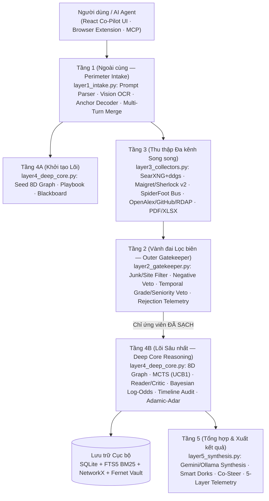

# Stalker++ — Tài liệu Kiến trúc Hệ thống, Công nghệ & Hướng dẫn Sử dụng

**Phiên bản:** 1.0 (Global & OSINT Ecosystem Edition)  
**Bản chất hệ thống:** Local-First Multi-Agent OSINT & 8-Dimensional Entity Resolution Workbench  
**Giấy phép:** MIT  

---

## 1. Tổng quan Hệ thống & Ranh giới Đạo đức

**Stalker++** là nền tảng trợ lý điều tra thông tin mở (OSINT) và phân giải thực thể đa chiều chạy hoàn toàn cục bộ trên máy người dùng (**Local-First**). Thay vì quét tên đăng nhập một cách máy móc dẫn đến tỷ lệ dương tính giả cao như các công cụ thế hệ cũ, Stalker++ kết hợp suy luận đa tác tử (**Multi-Agent**), cơ chế đồng thuận đa nguồn (**Parallel Metasearch Consensus**), đồ thị tri thức 8 chiều (**8D Entity Resolution**) và sự giám sát của con người (**Human-in-the-Loop Co-Steer**).

### Ranh giới Vận hành Bắt buộc
- **Chỉ thu thập dữ liệu công khai (Public OSINT Only):** Toàn bộ kết nối chỉ truy vấn các trang web, tài liệu công khai và API mở.
- **Không vượt tường bảo mật:** Hệ thống không tự động đăng nhập, không khai thác cookie xác thực, không giải hoặc vượt qua CAPTCHA, và không sử dụng các kỹ thuật dò quét quên mật khẩu trái phép.
- **Human-in-the-Loop cho nền tảng đóng:** Với các mạng xã hội yêu cầu đăng nhập, hệ thống sinh truy vấn Boolean Dork hoặc tiếp nhận đoạn trích dẫn công khai do chính người dùng chọn qua tiện ích mở rộng trình duyệt (Browser Companion Extension).
- **Bảo mật dữ liệu cục bộ:** Toàn bộ dữ liệu điều tra nằm trong SQLite trên máy người dùng; mọi khóa API được mã hóa tại nghỉ bằng thuật toán Fernet.

---

## 2. Kiến trúc Đồng tâm 5 Tầng (5-Layer Concentric OSINT Pipeline)

Toàn bộ luồng điều tra được phân lớp nghiêm ngặt trong gói `backend/app/pipeline/` theo nguyên tắc **Vành đai lọc ở ngoài — Lõi suy luận sâu nhất ở trong** (tách hoàn toàn khỏi lớp điều phối `agents/chat_orchestrator.py` nay chỉ còn là facade tương thích ngược). Mọi ứng viên từ internet đều **bắt buộc** đi qua Tầng 2 (`OuterGatekeeper`) trước khi được phép chạm vào Lõi Đồ thị Tri thức 8 chiều (Tầng 4).



### Chi tiết 5 Tầng Chuyên biệt

1. **Tầng 1 — Perimeter Intake & Anchor Decoding (`app/pipeline/layer1_intake.py`):**
   - Tách manh mối có cấu trúc (họ tên, ngày sinh `DD/MM/YYYY` hoặc ISO `YYYY-MM-DD`, tổ chức/từ viết tắt viết hoa, địa điểm, `@alias`, email, số điện thoại, URL, từ khóa loại trừ `-keyword`); tuyệt đối tách chuỗi toàn chữ số (MSSV/SBD) khỏi `aliases`.
   - Đọc OCR ảnh chụp màn hình qua Gemini/Ollama Vision, hợp nhất **Hồ sơ Tổng hợp (Verified Dossier)**, tọa độ bản đồ và lịch sử nhiều lượt hội thoại.
   - Giải mã mỏ neo đặc hiệu cao (MSSV suy luận khóa/năm nhập học, email học thuật, số hiệu văn bản, mã lớp) và tạo cấu trúc `InvestigationContext`.
2. **Tầng 2 — Outer Sanitization, Noise Shield & Temporal Veto (`app/pipeline/layer2_gatekeeper.py`):**
   - Đóng vai trò lá chắn vòng ngoài: loại bỏ nhanh trang rác, URL rỗng host, lỗi ghép tiêu đề và kết quả `site:` sai tên miền trước khi vào lõi.
   - Áp dụng 3 lớp phủ quyết cứng: **Negative Veto** (từ khóa loại trừ), **Temporal Seniority Veto** (chặn học hàm/chức danh cao bất hợp lý), và **Temporal Grade-Age Veto** (chặn mâu thuẫn tuổi học sinh/sinh viên theo năm sự kiện, ví dụ học lớp 11 năm 2018 cho mục tiêu sinh năm 2007).
   - Xác thực ngữ cảnh học thuật/khóa cho kết quả MSSV và xuất thống kê minh bạch theo từng lý do loại bỏ (`rejected_by_reason`).
3. **Tầng 3 — Multi-Channel Collectors & Maigret/Sherlock v2 (`app/pipeline/layer3_collectors.py`, `connectors/username_recon.py`):**
   - **Giai đoạn 3A:** Kiểm tra sức khỏe URL gốc + khôi phục bản lưu Wayback Machine + GitHub alias trực tiếp.
   - **Giai đoạn 3B:** Google AI Search Grounding 2 vòng (xoay vòng Key Pool + tự đổi model khi 404/503 + fallback không khóa key khi 429).
   - **Giai đoạn 3C (SpiderFoot Event Bus + Sherlock/Maigret v2):** Quét **55 nền tảng** với **5 engine tái sử dụng** (`DiscourseJson`, `MastodonApi`, `WordpressAuthor`, `GiteaApi`, `BlueskyApi`), xếp hạng ưu tiên theo `rank`, kiểm tra Soft-404 kiểu Sherlock `response_url` (chặn redirect HTTP 200 về `/login`, `/404`, trang chủ), **Per-Site Circuit Breaker**, và quét đệ quy 2 bước (`recursive_depth=2`) từ bio/`rel="me"`.
   - **Giai đoạn 3D:** Kho dữ liệu cấu trúc toàn cầu (OpenAlex/ORCID, GitHub Name Search, 5 nguồn Passive Domain Recon).
   - **Giai đoạn 3E:** Tìm kiếm song song `SearXNG ∥ ddgs` (`yahoo -> brave -> duckduckgo -> yandex`) + Mirror Pivots ưu tiên MSSV thuần + Đọc sâu tệp `.pdf`/`.xlsx`. Toàn bộ kết quả đều đi qua `OuterGatekeeper` (Tầng 2).
4. **Tầng 4 — Lõi Sâu nhất: Đồ thị Tri thức 8D & Suy luận MCTS (`app/pipeline/layer4_deep_core.py`):**
   - Chỉ nhận bằng chứng đã được Tầng 2 kiểm định.
   - Lưu nút/cạnh 8 chiều vào SQLite + FTS5 (BM25) + NetworkX; chạy cây giả thuyết **MCTS (UCB1)** kết hợp `ReaderAgent -> CriticVerifierAgent` (kiểm chứng trích dẫn gốc chống ảo giác), **Bayesian Log-Odds**, **Reflexion** quay lui, kiểm toán mâu thuẫn dòng thời gian, thẻ **Co-Steer** và dự đoán liên kết ẩn **Adamic-Adar**.
5. **Tầng 5 — Tổng hợp, Smart Dorks & Telemetry (`app/pipeline/layer5_synthesis.py`):**
   - Tổng hợp báo cáo bằng Gemini/Ollama hoặc bản tóm tắt xác định, khử trùng lặp Boolean Dorks, gắn `pipeline_telemetry` (thời gian từng tầng + phễu lọc Tầng 2) và lưu vào lịch sử phiên làm việc. Có thể kiểm tra kiến trúc sống và tình trạng manifest qua endpoint `GET /api/pipeline/architecture`.

---

## 3. Ngăn xếp Công nghệ & Thuật toán Cốt lõi

### 3.1. Công nghệ Phần mềm (Tech Stack)

| Tầng hệ thống | Công nghệ sử dụng | Vai trò chính |
|---|---|---|
| Backend API & Streaming | Python 3.12+, FastAPI, Uvicorn, Pydantic v2, httpx (async) | REST API, SSE streaming đa phiên, MCP JSON-RPC 2.0 |
| Cơ sở dữ liệu & Tìm kiếm cục bộ | SQLite 3, FTS5 (BM25), NetworkX | Lưu trữ bền vững, tìm kiếm ngữ nghĩa nhẹ, thuật toán đồ thị |
| Xử lý Tài liệu & Bảo mật | `pypdf`, `openpyxl`, `cryptography` (Fernet) | Đọc bảng PDF/Excel công khai, mã hóa API key tại nghỉ |
| Công cụ Tìm kiếm Mở | Self-hosted SearXNG (Docker, JSON API), `ddgs`, Serper (tùy chọn) | Metasearch song song và tổng hợp đồng thuận |
| Mô hình Ngôn ngữ (LLM) | Google Gemini API (Multi-Key Pool + Vision), Ollama Local, OpenAI-Compatible | Tổng hợp bằng chứng, OCR ảnh, hỗ trợ chế độ 100% cục bộ |
| Giao diện Người dùng (Frontend) | React 19, TypeScript 5.7, Vite 6, Tailwind CSS v4, `react-markdown`, `remark-gfm`, `lucide-react` | Co-Pilot 3 cột, Markdown chuẩn GFM, Timeline, Inspector |
| Tiện ích & Đóng gói | Chrome/Edge Extension (Manifest V3), Docker Multi-Stage, Docker Compose, GitHub Actions CI | Thu thập Human-in-the-Loop, triển khai 1 lệnh, kiểm thử tự động |

### 3.2. Các Thuật toán & Mô hình Chuyên sâu

1. **Mô hình Thực thể 8 Chiều (`backend/app/core/schemas.py`):**
   - 8 nhóm đặc trưng (`FeatureCategory`): `IDENTITY_CORE`, `ONLINE_ALIAS`, `EDUCATION_CAREER`, `GEO_SPATIAL`, `TEMPORAL_BEHAVIOR`, `SOCIAL_GRAPH`, `STYLOMETRY_LINGUISTIC`, `TECHNICAL_ARTIFACT`.
   - Mỗi khẳng định (`FeatureClaim`) lưu rõ cực tính `POSITIVE` hoặc `NEGATIVE` (cơ chế phủ quyết cứng), độ tin cậy, URL nguồn và câu trích dẫn gốc.
2. **Chuẩn hóa Ngôn ngữ & So khớp Mờ (`backend/app/core/normalizer.py`):**
   - Khử dấu tiếng Việt (xử lý chuẩn `đ/Đ`), mở rộng viết tắt trường học/địa danh song ngữ (`UEH`, `UIT`, `USSH`, `UMP`, `HCMUT`, `HUST`, `HCMUS`, `UEL`, `FTU`, `UET`, `TPHCM`, `HN`).
   - So khớp chuỗi bằng **Jaro-Winkler** và mã ngữ âm chịu lỗi chính tả tiếng Việt (`phonetic_vietnamese_key`: chuẩn hóa `tr/ch`, `gi/r/d`, `s/x`, `i/y`).
3. **Cập nhật Xác suất Bayesian Log-Odds (`backend/app/core/bayesian.py`):**
   - Cập nhật niềm tin hậu nghiệm theo Log-Odds, áp dụng hệ số suy giảm $1/\sqrt{k}$ đối với các trích dẫn lặp từ cùng một tên miền nhằm chống hiệu ứng phòng vang (Echo-Chamber).
4. **Dấu vân tay Hành vi & Văn phong (`backend/app/core/fingerprints.py`, `connectors/github_api.py`):**
   - Giải phẫu cấu trúc đặt tên tài khoản (`extract_handle_fingerprint`), so khớp văn phong Stylometry (TTR, độ dài câu, tỷ lệ chêm ngoại ngữ, vector 3-gram ký tự cosine), mã băm Gravatar MD5, và suy luận múi giờ hoạt động thực tế từ dấu thời gian commit công khai trên GitHub (`analyze_active_hours_utc`).
5. **Giải mã Mỏ neo & Kẹp khoảng Bảo thủ (`backend/app/core/anchor_decoder.py`):**
   - Giải mã tự động cấu trúc MSSV, email học thuật, số hiệu quyết định hành chính, mã lớp và mã lớp học phần.
   - Thuật toán `bracket_numeric_ids` kẹp khoảng mã số giữa cận dưới và cận trên trong danh sách công khai với xác suất hiệu chỉnh bảo thủ (không bao giờ kết luận 100% khi nằm giữa hai phân loại khác nhau).
6. **Phân tích Đồ thị Mạng (`backend/app/core/graph_analytics.py`):**
   - Dự đoán liên kết ẩn bằng chỉ số **Adamic-Adar**, phát hiện cộng đồng bằng **Label Propagation**, tìm nút cầu nối bằng **Betweenness Centrality**, và xếp hạng điểm neo tiếp theo theo Độ lợi Thông tin (`suggest_pivots`).
7. **Lập kế hoạch Cây Giả thuyết MCTS (UCB1) & Reflexion (`backend/app/agents/planner.py`):**
   - Chọn nhánh điều tra theo công thức UCB1, tự động quay lui khi gặp ngõ cụt (`DEAD_END_BACKTRACKED`) và sinh từ khóa loại trừ mới từ dữ liệu nhiễu.
8. **Kho Khóa API Xoay vòng & Mã hóa (`backend/app/core/key_pool.py`, `backend/app/core/crypto.py`):**
   - Mã hóa khóa API bằng **Fernet** (`enc::...`) với khóa cục bộ lưu tại `backend/data/.stalker_key` (được loại khỏi Git).
   - Cơ chế xoay vòng Round-Robin (least-recently-used) kèm thời gian chờ (cooldown) tự động khi gặp HTTP 429.

---

## 4. Hệ sinh thái 11 Built-in Plugins & Kiến trúc Kế thừa Quốc tế

Kiến trúc Plugin SDK (`backend/app/plugins/base.py`, `registry.py`, `event_bus.py`, `correlator.py`) áp dụng mô hình **Event-Driven Pub/Sub** (học từ SpiderFoot), cho phép tự động nạp thêm plugin cộng đồng thả vào thư mục `plugins/*.py`.

| STT | Plugin ID | Nhóm | Chức năng chính | Kiến trúc tham chiếu | Sự kiện Pub/Sub |
|---|---|---|---|---|---|
| 1 | `parallel_metasearch` | search | Chạy song song SearXNG + `ddgs`, trộn Consensus-First + Round-Robin | SearXNG, `ddgs` | Trực tiếp |
| 2 | `deep_document_reader` | document | Tải và trích dòng khớp mục tiêu trong PDF/XLSX công khai (tối đa 12 MB), nhận diện PDF scan | Native Python | Trực tiếp |
| 3 | `username_multi_platform` | social | Quét 45 nền tảng + 3 engine (`DiscourseJson`, `MastodonApi`, `WordpressAuthor`), chấm điểm 0-100, trích xuất JSON-LD/`rel="me"`, xoay vòng bio đệ quy | Sherlock, Maigret, Social-Analyzer | Nhận: `HANDLE_FOUND` / Phát: `EMAIL_FOUND`, `HANDLE_FOUND`, `URL_FOUND` |
| 4 | `phone_footprint_analyzer` | enrichment | Giải mã E.164, RFC 3966, nhà mạng Việt Nam/quốc tế, sinh 5 nhóm dork (tổng quát, MXH, SIM ảo disposable, uy tín, cá nhân/PDF) | PhoneInfoga v2 | Nhận: `PHONE_FOUND` |
| 5 | `passive_dns_email_crypto` | enrichment | 5 nguồn tên miền thụ động 0 API key (Cloudflare DoH `A/MX/TXT`, RDAP/crt.sh, Wayback CDX, URLScan.io, Shodan InternetDB) + Gravatar JSON + OpenPGP VKS | theHarvester, OWASP Amass | Nhận: `EMAIL_FOUND`, `DOMAIN_FOUND` / Phát: `DOMAIN_FOUND`, `URL_FOUND` |
| 6 | `github_public_footprint` | social | Thu thập hồ sơ GitHub, repo công khai và suy luận múi giờ hoạt động UTC | GitHub REST API | Trực tiếp |
| 7 | `wayback_archive_recovery` | archive | Chẩn đoán lỗi mạng URL gốc, khôi phục bản lưu Wayback Machine và xoay trục kho tài liệu | Internet Archive API | Trực tiếp |
| 8 | `browser_companion_clipper` | enrichment | Cầu nối tiếp nhận đoạn văn bản công khai từ tiện ích Chrome/Edge Companion | Human-in-the-Loop | Trực tiếp |
| 9 | `openalex_global_research` | enrichment | Tra cứu 250 triệu+ hồ sơ học giả toàn cầu, cơ quan công tác, ORCID và dòng thời gian xuất bản | OpenAlex Public API | Trực tiếp |
| 10 | `domain_rdap_crtsh` | enrichment | Kiểm tra ngày đăng ký RDAP và nhật ký chứng chỉ SSL `crt.sh` | RDAP, crt.sh | Trực tiếp |
| 11 | `external_osint_cli_bridge` | enrichment | Tự động phát hiện các CLI OSINT cài sẵn trên máy (`sherlock`, `maigret`, `theHarvester`, `phoneinfoga`, `amass`) | OpenOSINT, OSINT-Tools | Trực tiếp |

### Bộ Luật Tương quan Chéo (`backend/app/plugins/correlator.py`)
Sau khi các plugin hoàn tất chạy đa bước, `OSINTCorrelator` tự động kiểm tra 4 luật:
- `CORR_CROSS_PLATFORM_IDENTITY`: Xác nhận danh tính trùng khớp trên từ 2 nền tảng độc lập trở lên.
- `CORR_INDIEWEB_REL_ME`: Phát hiện các liên kết tự chứng thực chéo `rel="me"` hoặc Schema.org `sameAs`.
- `CORR_CRYPTO_EMAIL_VERIFIED`: Xác nhận email công khai được chứng thực đồng thời qua Gravatar hoặc khóa công khai OpenPGP.
- `CORR_MULTI_SOURCE_INFRASTRUCTURE` & `CORR_MULTI_HOP_PIVOT_CHAIN`: Xác nhận hạ tầng tên miền từ nhiều nguồn thụ động độc lập và ghi nhận chuỗi suy luận đa hop.

---

## 5. Danh mục Chức năng Thực tế Hiện có trên Phần mềm

### 5.1. Giao diện Web Co-Pilot (`http://127.0.0.1:8000`)
- **Quản lý đa cuộc điều tra (Workspaces):** Tạo mới, đổi tên, xóa phiên điều tra; lưu bền vững lịch sử trò chuyện và hồ sơ tổng hợp trong SQLite.
- **Streaming đồng thời theo từng phiên (Per-Workspace Concurrent Streaming):**
  - Có thể chạy đồng thời nhiều cuộc điều tra ở các tab khác nhau mà không bị ngắt hay lẫn kết quả.
  - Đèn báo trạng thái chạy ngầm cạnh tên cuộc điều tra trên thanh bên trái.
  - Nút **Stop** dừng tức thì kết nối SSE của đúng cuộc điều tra đang mở.
- **Soạn thảo đa phương thức (Composer):**
  - Nhập manh mối cách nhau bằng dấu phẩy và ràng buộc loại trừ (`-từ_khóa`).
  - Nút `+` cho phép đính kèm ảnh chụp (hoặc dán `Ctrl+V` để chạy Vision OCR), tệp văn bản/CSV, chèn URL công khai, hoặc mở **Google Maps Picker** chọn địa điểm/tọa độ.
  - Chọn model AI (`Gemini 3.5 Flash-Lite`, `Gemini 4 Hydrogen`, `Gemini 3.6 Flash`, `Gemini 3.1 Flash-Lite`, `Gemini 3.8 Flash`) và công tắc bật/tắt **Deep ReAct**.
  - Chuyển đổi giao diện sáng/tối (**Dark / Light**) và song ngữ (**VI / EN**).
- **Hiển thị kết quả chuẩn kỹ thuật:**
  - Render báo cáo Markdown GFM đầy đủ (tiêu đề, danh sách, bảng, mã nguồn), hộp ẩn/hiện chi tiết từng bước suy luận Multi-Agent.
  - Thẻ **Co-Steer** cảnh báo người trùng tên kèm nút 1-click loại trừ (`-TổChức`) hoặc xác nhận.
  - Thẻ nguồn công khai hiển thị điểm khớp, nhãn `PDF Đọc sâu`, nhãn `SearXNG ∩ ddgs`, nút **Trích dẫn** và nút **Lưu vào Hồ sơ** (tự khóa thành **Đã thêm** khi đã lưu, tự mở khóa nếu người dùng xóa khỏi hồ sơ).
- **Bảng điều khiển phải 3 tab:**
  1. **Hồ sơ Tổng hợp (Verified Dossier):** Thêm/sửa/xóa thủ công có chống trùng lặp theo URL chuẩn hóa và cặp Trường-Giá trị; dữ liệu đã ghim tự động làm ngữ cảnh cho các lượt tìm kế tiếp.
  2. **Dòng thời gian (Timeline):** Hiển thị các mốc thời gian theo trình tự năm, tự động đánh dấu đỏ `XUNG ĐỘT TUỔI` nếu có mâu thuẫn.
  3. **Trích dẫn (Evidence Inspector):** Xem chi tiết trích đoạn của nguồn đang chọn và nút **Đọc sâu file PDF/Excel này ngay** cho các tài liệu trực tuyến.
- **Trung tâm Kết nối & Plugins (4 Tab):** Quản lý API Key Pool (mã hóa Fernet), cấu hình Host Local (quét model Ollama & nút **Test SearXNG**), xem trạng thái live của 11+ plugins, và sao chép nhanh cấu hình MCP / hướng dẫn Browser Extension.

### 5.2. Xuất Báo cáo Chuẩn Quốc tế
- **Obsidian Markdown (`.md`):** Bao gồm YAML frontmatter, bảng Dossier, thực thể đồ thị với `[[wikilinks]]` và liên kết nguồn. Hỗ trợ bật cờ **Ẩn danh PII (`?redact=true`)** tự động che email, số điện thoại, ngày sinh và mã số 8–12 chữ số trước khi chia sẻ.
- **STIX 2.1 Bundle (`.json`):** Xuất đối tượng `identity`, `relationship`, `note` chuẩn tình báo mạng quốc tế (tương thích MISP, OpenCTI, Maltego), hỗ trợ `?redact=true`.
- **CSV / JSONL / GEXF:** Xuất bảng phẳng cho Excel/Pandas, tập dữ liệu JSONL và đồ thị `.gexf` cho Gephi.

### 5.3. Tiện ích Trình duyệt & Kết nối AI Agent (MCP)
- **Chrome / Edge Companion Extension (`extension/`):** Tiện ích Manifest V3 cho phép bôi đen đoạn văn bản công khai trên bất kỳ trang web nào và đẩy thẳng vào Hồ sơ Tổng hợp (hoặc kích hoạt Agent phân tích) qua `POST /api/workspaces/{id}/clip`.
- **Máy chủ MCP JSON-RPC 2.0 (`backend/app/mcp_server.py`):** Hỗ trợ cả HTTP (`/api/mcp`) và Stdio (`python -m app.mcp_server`) với **11 MCP Tools** cho Antigravity, Claude Code, Codex và Cursor.

---

## 6. Hướng dẫn Cài đặt & Sử dụng Chi tiết

### 6.1. Cách 1: Chạy 1 lệnh bằng Docker Compose (Khuyên dùng)
Yêu cầu đã cài Docker Desktop. Tại thư mục gốc của dự án:

```bash
docker compose up -d
```

Lệnh này tự động build và khởi chạy đồng bộ:
- **Stalker++ Workbench** tại `http://127.0.0.1:8000`
- **SearXNG Local** (đã bật sẵn `format=json`) tại `http://127.0.0.1:8888`

### 6.2. Cách 2: Chạy trực tiếp trên máy cục bộ (Phát triển / Tùy biến)

```powershell
# 1. Khởi động SearXNG cục bộ (tùy chọn, giúp chạy song song SearXNG + ddgs)
cd searxng
docker compose up -d
cd ..

# 2. Cài đặt Backend Python
cd backend
python -m venv .venv
.\.venv\Scripts\python.exe -m pip install -r requirements.txt

# 3. Build giao diện Frontend React (FastAPI sẽ tự phục vụ tại cổng 8000)
cd ..\frontend
npm install
npm run build

# 4. Chạy máy chủ Stalker++
cd ..\backend
.\.venv\Scripts\python.exe -m uvicorn app.main:app --reload --port 8000
```

Mở trình duyệt tại `http://127.0.0.1:8000`.

### 6.3. Cấu hình Tìm kiếm & AI trong Giao diện
1. Bấm **Kết nối & Plugins** ở góc trên bên phải.
2. **Tab Host Local:**
   - Nhập `http://localhost:8888` (hoặc `http://searxng:8080` nếu chạy cùng Docker network) vào ô **SearXNG Local URL**, bấm **Test SearXNG** để xác nhận `SearXNG OK`, sau đó bấm **Lưu Host Local**.
   - Nếu muốn chạy AI 100% cục bộ không cần API cloud, nhập URL Ollama (`http://localhost:11434`), bấm **Quét Ollama**, chọn model (ví dụ `qwen2.5:7b`) và chọn chế độ `100% Host Local`.
3. **Tab API Key Pool:**
   - Thêm một hoặc nhiều khóa **Gemini** (để tổng hợp báo cáo & Vision OCR) và tùy chọn khóa **Serper** (nếu cần chỉ mục Google Search JSON trực tiếp khi Google chặn IP cục bộ của SearXNG). Hệ thống tự mã hóa Fernet và tự xoay vòng khóa.

### 6.4. Quy trình Sử dụng Hiệu quả
1. **Nhập manh mối rõ ràng cách nhau bằng dấu phẩy:**
   - Ví dụ mẫu tổng hợp: `Nguyễn Minh Anh, 15/06/2005, UEH, 31251029999, -ca sĩ`
   - Hoặc điều tra theo tài khoản/hạ tầng: `Alex Demo, @alexdemo99, examplelab.org`
   - Hoặc phân tích số điện thoại công khai: `0987.654.321, Nguyễn Minh Anh`
2. **Kiểm chứng & Ghim Hồ sơ:**
   - Bấm **Trích dẫn** trên thẻ nguồn để xem nội dung đọc sâu PDF/Excel ở panel bên phải.
   - Bấm **Lưu vào Hồ sơ** cho các nguồn chính xác. Các dữ kiện đã ghim sẽ tự động bổ sung ngữ cảnh cho những lượt hỏi tiếp theo trong cùng cuộc điều tra.
3. **Xử lý người trùng tên:**
   - Khi thấy hộp cảnh báo **Co-Steer**, bấm nút loại trừ (`-...`) để hệ thống tự động lọc bỏ nhánh sai và cập nhật kết quả, hoặc kiểm tra tab **Timeline** để rà soát xung đột tuổi tác.
4. **Xuất báo cáo:**
   - Trong tab **Hồ sơ**, tích chọn **Ẩn danh PII khi xuất** nếu cần chia sẻ công khai, rồi chọn định dạng **Obsidian**, **STIX 2.1**, hoặc **CSV**.

### 6.5. Cài đặt Tiện ích Trình duyệt (Chrome / Edge Companion)
1. Mở `chrome://extensions` (hoặc `edge://extensions`).
2. Bật **Developer mode**, bấm **Load unpacked** và chọn thư mục `extension/`.
3. Khi đang xem một trang công khai, bôi đen đoạn văn bản cần lưu, bấm biểu tượng **Stalker++** trên thanh công cụ, chọn cuộc điều tra và bấm **Lưu vào Hồ sơ** hoặc **Lưu + Phân tích**.

### 6.6. Mở rộng Plugin & Danh sách Nền tảng
- **Thêm Community Plugin:** Tạo một tệp Python trong thư mục `plugins/` kế thừa `ConnectorPlugin` và định nghĩa hàm `register_plugin()` (xem mẫu tại `plugins/README.md`).
- **Mở rộng danh sách quét Username lên hàng nghìn trang:** Đặt tệp JSON chuẩn Maigret (`data.json`) hoặc Sherlock vào `backend/data/custom_sites.json`; `username_recon.py` sẽ tự động nạp bổ sung khi khởi động.

---

## 7. Bảng Tham chiếu REST API & MCP Tools

### 7.1. Các Nhóm REST Endpoint Chính (`http://127.0.0.1:8000`)

| Nhóm chức năng | Method & Endpoint | Mô tả |
|---|---|---|
| Phiên điều tra | `GET/POST /api/workspaces`, `PATCH/DELETE /api/workspaces/{id}` | Quản lý cuộc điều tra |
| Trò chuyện & Stream | `POST /api/workspaces/{id}/chat`, `POST /api/workspaces/{id}/chat/stream` | Chạy vòng lặp Deep ReAct (JSON hoặc SSE) |
| Hồ sơ Tổng hợp | `GET/POST /api/workspaces/{id}/dossier`, `PATCH/DELETE /api/dossier/{item_id}` | CRUD Hồ sơ Tổng hợp có chống trùng |
| Đồ thị & Phân tích | `GET /api/workspaces/{id}/graph`, `/paths`, `/search`, `/pivots`, `/analytics` | Truy vấn đồ thị 8D, FTS5, Adamic-Adar |
| Công cụ Chuyên môn | `POST /api/tools/scan-username`, `/analyze-phone`, `/recon-domain-email`, `/inspect-document`, `/event-bus` | Gọi trực tiếp từng chuyên gia OSINT và Plugin Bus |
| Trình duyệt & Plugins | `POST /api/workspaces/{id}/clip`, `GET /api/plugins` | Nhận dữ liệu từ Extension, kiểm tra sức khỏe 11+ plugins |
| Xuất báo cáo | `GET /api/workspaces/{id}/export/{obsidian,stix,csv,jsonl,gexf}` | Xuất dữ liệu chuẩn quốc tế (Obsidian/STIX hỗ trợ `?redact=true`) |
| Tích hợp & Cài đặt | `GET/POST/PATCH/DELETE /api/integrations/keys`, `GET/POST /api/integrations/local`, `GET /api/integrations/searxng/test`, `/ollama/models`, `/mcp-config` | Quản lý Key Pool Fernet, Host Local và cấu hình MCP |
| AI-Native & Đánh giá | `POST /api/mcp`, `GET /llms.txt`, `GET /llms-full.txt`, `GET /api/catalog.json`, `GET /api/evaluation/benchmark` | Máy chủ MCP, tài liệu máy đọc và bộ đo định lượng |

### 7.2. Danh sách 11 MCP Tools (`/api/mcp` & Stdio)
1. `stalker_generate_dorks` — Sinh Boolean search dorks đa biến thể kèm từ khóa loại trừ.
2. `stalker_ingest_snippet` — Nạp đoạn văn bản công khai và tự trích xuất đặc trưng lên nút đồ thị.
3. `stalker_analyze_and_verify` — Chạy `ReaderAgent -> CriticVerifierAgent` ghi nhận bằng chứng đã kiểm chứng.
4. `stalker_resolve_entities` — So khớp 2 thực thể trên 8 chiều (có phủ quyết `NEGATIVE`).
5. `stalker_search_graph` — Tìm kiếm ứng viên qua SQLite FTS5 (BM25) kết hợp Jaro-Winkler.
6. `stalker_suggest_pivots` — Xếp hạng nút có Độ lợi Thông tin cao nhất cho bước điều tra tiếp theo.
7. `stalker_deep_investigate` — Chạy toàn bộ pipeline Deep ReAct + Mirror Pivoting + 8D Graph.
8. `stalker_decode_anchors` — Giải mã mỏ neo độ đặc hiệu cao (MSSV, email học thuật, số văn bản, mã lớp).
9. `stalker_scan_username` — Quét username đa nền tảng (45+ site, 0-100 score, JSON-LD/`rel="me"`, bio pivot).
10. `stalker_analyze_phone` — Phân tích số điện thoại E.164/RFC 3966, nhà mạng và sinh 5 nhóm PhoneInfoga dorks.
11. `stalker_recon_domain_email` — Chạy 5 nguồn hạ tầng tên miền thụ động (0 API key) + Gravatar + OpenPGP.

---

## 8. Kiểm thử & Đảm bảo Chất lượng

Toàn bộ bộ kiểm thử sử dụng **100% dữ liệu tổng hợp (synthetic data)** và HTTP mock ngoại tuyến, không chứa dữ liệu cá nhân thực tế:

```powershell
# Kiểm thử Backend (50 unit & integration tests)
cd backend
.\.venv\Scripts\python.exe -m pytest -v

# Kiểm thử biên dịch TypeScript & đóng gói Frontend
cd ..\frontend
npm run build
```

- **Trạng thái kiểm thử hiện tại:** 50/50 unit & integration tests đạt (bao phủ đầy đủ các giai đoạn 1–5, mã hóa Fernet, đọc PDF/XLSX, xuất Obsidian/STIX có ẩn danh PII, Global Edition, và toàn bộ 11 plugins hệ sinh thái OSINT).
- **Tự động hóa CI:** Cấu hình tại `.github/workflows/ci.yml` tự động chạy toàn bộ `pytest` và `frontend` build trên mỗi lần push hoặc Pull Request.
