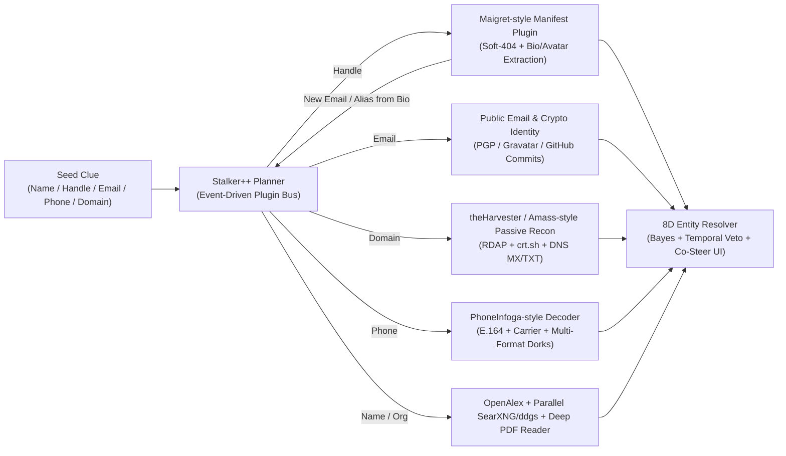

# OSINT Ecosystem Reference & Architectural Blueprint for Stalker++

> **Purpose**: Curated reference catalog of battle-tested open-source OSINT repositories to study, extract domain-specific engineering patterns from, and adapt into **Stalker++**'s **Plugin SDK** (`plugins/`) and **Multi-Agent MCP Architecture** — while strictly respecting public-OSINT ethical & legal guardrails.

---

## 1. Username & Social Profile Discovery (Input: `@username` / Handle)

| Repository | GitHub Stars | Core Strength | Key Patterns to Adopt into Stalker++ |
|---|---:|---|---|
| [sherlock-project/sherlock](https://github.com/sherlock-project/sherlock) | ~60k+ | Fast username sweeps across 400+ platforms, clean CLI/Docker packaging | Declarative JSON site-manifest format (`data.json`), per-site status-code & error-string definitions |
| [soxoj/maigret](https://github.com/soxoj/maigret) | ~15k+ | 3,000+ sites, extracts profile metadata (real name, bio, avatar, IDs) & **recursive username discovery** from bios | **Recursive Pivot Chaining** (extract new handles/emails from bio → auto-enqueue next hop), avatar hash cross-matching, Soft-404 signature library |
| [qeeqbox/social-analyzer](https://github.com/qeeqbox/social-analyzer) | ~12k+ | Web UI, **0–100 confidence scoring** per discovered profile, cross-profile link graphing | Multi-factor profile verification score (`detected`, `metadata_overlap`, `link_graph`) mapped directly into Stalker++'s 8D Entity Resolution |

---

## 2. Email & Domain Intelligence (Input: Email / Organization Domain)

| Repository | GitHub Stars | Core Strength | Key Patterns to Adopt into Stalker++ |
|---|---:|---|---|
| [mxrch/GHunt](https://github.com/mxrch/GHunt) | ~16k+ | Deep Google ecosystem correlation (Google ID, public reviews/Maps activity, public YouTube/Calendar) | **Spatiotemporal Activity Inference** (inferring region/timezone from public timestamps & public geo-reviews) — *Note: Stalker++ strictly avoids authenticated cookie scraping* |
| [megadose/holehe](https://github.com/megadose/holehe) | ~7k+ | Cross-service email existence checking across 120+ platforms | Standardized multi-service check interface & async rate-limited worker pool — *Note: Stalker++ keeps public-only guardrails and avoids abusive forgot-password enumeration* |
| [laramies/theHarvester](https://github.com/laramies/theHarvester) | ~12k+ | Organizational domain recon across search engines, SSL Certificate Transparency (`crt.sh`), DNS, and public listings | **Org-Domain Recon Plugin**: expand Stalker++'s `global_intel.py` (`RDAP + crt.sh`) with DNS (`MX`/`TXT`/`SPF`) and public corporate email-pattern inference (`first.last@org.com`) |

---

## 3. Phone Number Intelligence (Input: Phone Number)

| Repository | GitHub Stars | Core Strength | Key Patterns to Adopt into Stalker++ |
|---|---:|---|---|
| [sundowndev/phoneinfoga](https://github.com/sundowndev/phoneinfoga) | ~13k+ | Official canonical repo (avoid unverified forks). Parses country code, carrier, line type, and synthesizes targeted **Phone Footprint Dorks** | **Phone Anchor Decoder Plugin**: parse E.164 / Vietnamese carrier prefixes (`Viettel`, `Vinaphone`, `Mobifone`, etc.), normalize formats (`+84...` / `0...` / `09xx.xxx.xxx`), and generate public-listing Boolean dorks + Human-in-the-loop verification checklist |

---

## 4. Broad Automated Recon & Graph Pipelines (All-in-One)

| Repository | GitHub Stars | Core Strength | Key Patterns to Adopt into Stalker++ |
|---|---:|---|---|
| [smicallef/spiderfoot](https://github.com/smicallef/spiderfoot) | ~13k+ | 200+ event-driven OSINT modules; one seed (domain, IP, email, name) cascades automatically into correlated graph entities | **Event-Driven Plugin Bus**: each `ConnectorPlugin` declares `consumes_events` (e.g. `EMAIL_FOUND`, `DOMAIN_FOUND`, `HANDLE_FOUND`) and emits typed claims to trigger downstream plugins automatically |
| [lanmaster53/recon-ng](https://github.com/lanmaster53/recon-ng) | ~4k+ | Metasploit-style modular marketplace + local SQLite workspace with SQL querying | Structured SQLite relational tables per entity type + inspectable SQL/FTS5 query workbench (already aligned with Stalker++'s SQLite + FTS5 core) |
| [owasp-amass/amass](https://github.com/owasp-amass/amass) | ~12k+ | OWASP flagship attack-surface & infrastructure mapping (subdomains, ASN, IP ranges, SSL certs) | **Infrastructure Graph Enrichment**: passive subdomain/ASN/cert correlation for organizational targets owning public web infrastructure |

---

## 5. AI Agent & MCP Integration Ecosystem (2025–2026 Frontier)

| Repository | Core Strength | Key Patterns to Adopt into Stalker++ |
|---|---|---|
| [kaifcodec/user-scanner](https://github.com/kaifcodec/user-scanner) | Unified Email + Username scanning (2,700+ sources) exposed directly via an **MCP Server** | Single normalized MCP tool schema returning structured confidence scores + evidence URLs for LLM agents |
| [OpenOSINT/OpenOSINT](https://github.com/OpenOSINT/OpenOSINT) | Bundles 21 classic passive OSINT tools into a zero-API-key MCP server / AI Agent | **Zero-Key Passive First** design + standardized tool registry wrapping optional external CLI tools cleanly |
| [yogsec/OSINT-Tools](https://github.com/yogsec/OSINT-Tools) | Unified MCP wrapper orchestrating Sherlock, Maigret, GHunt, Holehe, theHarvester, PhoneInfoga | **Optional External CLI Bridge Plugin**: auto-detect if a user has `maigret`, `sherlock`, `theHarvester`, or `phoneinfoga` installed locally and expose them safely to Stalker++'s Planner Agent & MCP Server |

---

## 6. Target Multi-Hop Investigation Workflow (To Implement Next)

## 7. Action Plan for Deep Extraction & Integration (Tomorrow's Roadmap)

1. **Upgrade Plugin SDK to Event-Driven Pub/Sub (SpiderFoot pattern)**:
   - Add `consumes: list[str]` and `produces: list[str]` to `PluginManifest` in `backend/app/plugins/base.py` so discovering an email, handle, domain, or phone automatically triggers the exact matching specialist plugins.
2. **Build Built-in Native Python Plugins (Zero Heavy External Setup)**:
   - **Plugin A — Declarative Username Checker (Sherlock/Maigret pattern)**: JSON-driven public profile checker with Soft-404 fingerprints + bio/avatar metadata extraction + recursive handle pivot.
   - **Plugin B — Passive Domain & DNS Recon (theHarvester/Amass pattern)**: Extend `global_intel.py` with passive DNS (`MX`/`TXT`/`SPF`), `crt.sh`, RDAP, and public org email-format inference.
   - **Plugin C — Phone Number Decoder & Multi-Format Dorker (PhoneInfoga pattern)**: E.164 parsing, Vietnam/global carrier lookup, multi-format normalization (`+84`, `0xxx`, dotted/spaced), and targeted public dork synthesis.
   - **Plugin D — Optional Local CLI MCP Bridge (`yogsec`/`OpenOSINT` pattern)**: Safely detect locally installed CLI tools (`maigret`, `sherlock`, `theHarvester`, `phoneinfoga`) without bundling invasive scrapers by default.
3. **Strict Ethical & Legal Guardrails**:
   - **Public OSINT only**: No login-wall bypass, no authenticated cookie harvesting, no CAPTCHA evasion, no unauthorized credential/breach dumps.
   - Sensitive or closed-platform checks remain strictly **Human-in-the-Loop** (generated dorks + Browser Companion Extension).
